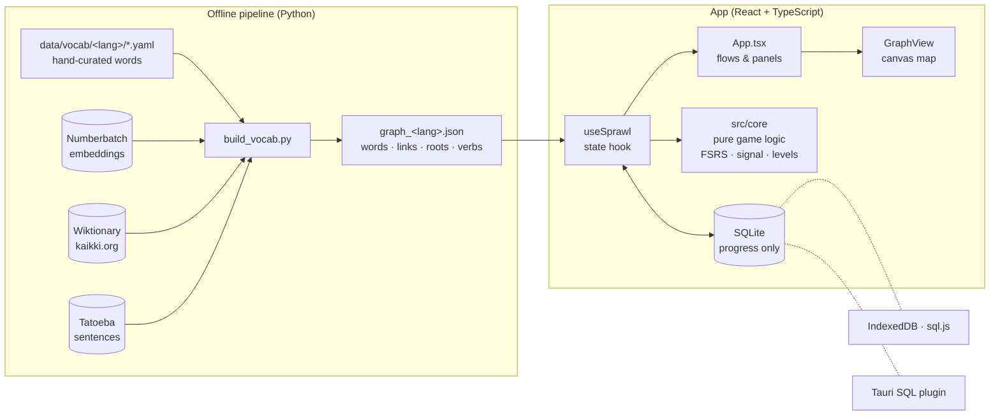

<div align="center">


# Plexus

**Learn a language by growing a mind map.**
Every word is a node; every word you learn lights up the ones around it.

[**▶ Play it in your browser**](https://plexus-9vf.pages.dev/) &nbsp;·&nbsp; Italian · Spanish · German, from English


<sub>Two hundred answers, a few in-game days: from one word to a lit-up network.</sub>

</div>

---

## Why another vocabulary app?

Flashcard apps treat words as a pile. Plexus treats them as a **network**, which is how memory works anyway: *la cucina* (kitchen) sits next to *cucinare* (to cook), *il cuoco* (cook) and *il forno* (oven); *la madre* is linked to *il padre*; *notte* shares a Latin root with *nocturnal*.

- **You can only reach what's next to what you know.** Answering a word starts learning it and reveals its neighbours. The map grows outwards from a core word you pick.
- **Memory is real.** Each word is scheduled with [FSRS](https://github.com/open-spaced-repetition/fsrs4anki/wiki/The-Algorithm), a modern spaced-repetition model. Words you don't review fade on the map, letter by letter.
- **Words hold each other up.** Every word you know sends a *signal* along its links: more the better you know it. A word needs enough signal from its neighbours to stay connected. Forget a key word and the ones behind it go dark until you fix it. Reviewing is no longer a chore: it's keeping your map alive.
- **Real language, not lists.** About 2,600 words per language in 44 topics, with CEFR levels (A1 → C1), example sentences from Tatoeba, Latin and Germanic roots, English cousins (*pflücken* → *pluck*) and conjugation drills for every verb.

<table>
<tr>
<td width="50%"></td>
<td width="50%"></td>
</tr>
<tr>
<td><b>Where the signal comes from.</b> Select a word: its suppliers light up with their share, and nearby unknown words show what learning them would add.</td>
<td><b>Typed answers, in context.</b> Reviews into Italian are fill-the-gap sentences. Answers forgive articles, accents and small typos, but say so.</td>
</tr>
<tr>
<td></td>
<td></td>
</tr>
<tr>
<td><b>The whole network.</b> All 2,663 Italian words and 4,560 links, one star per word, nebulae per topic.</td>
<td><b>Levels per topic.</b> Every topic climbs its own CEFR ladder; an overall level (words + verb tenses) keeps them in step.</td>
</tr>
</table>

<p align="center">

<br /><sub>The same build runs as an Android app and as a mobile web page.</sub>
</p>

---

## Under the hood

Plexus is about 13,000 lines of TypeScript (plus 2,200 lines of tests) and a 3,700-line Python data pipeline. Some of the parts I'm proudest of:

### 1 · A signal network that stays fast and explainable

The core mechanic ([`src/core/supply.ts`](src/core/supply.ts)) is a flow problem. Every known word is a source that sends out between 5% and 100%, depending on how well you remember it. For each source a **widest-path search** spreads that signal through the words you know, and each link passes on at most its strength. A word's signal is the sum of everyone else's shares (never its own echo), and it needs 50% to stay connected.

- Runs on **flat typed arrays** with a hand-rolled binary heap: ~20 ms for 500 known words, recomputed after every answer.
- **Incremental what-ifs.** "How many words depend on this one?" and "what would learning that word add?" recount only the sources whose signal actually passes through the word in question (~3 ms instead of a full recount). Tests check every incremental answer against a full recomputation.
- **Event-ordered simulation.** Words weaken on a timetable set by their memory curve. When you come back after a week, [`advanceSiege`](src/core/supply.ts) replays every break and fade in time order and reroutes the signal at each one, so cascades play out exactly as they would have live.
- **Explainable.** `contributions` returns each supplier's share and path. Shares are rounded with the largest-remainder method, so the badges on the map add up to the total in the side panel.

### 2 · A pure, tested game core

Everything in [`src/core/`](src/core/) is pure TypeScript with no React or database imports, and has its own test file: scheduling, answer checking, the three-step learning flow, CEFR levels, verb tenses, the review queue, streaks, achievements. Time comes from one injectable clock ([`clock.ts`](src/core/clock.ts)), never `new Date()`, so a whole week can be simulated in a test, and the in-game time travel and the idle fast-forward work the same way.

```ts
// From supply.test.ts: an incremental answer must match a full recount.
test('what hangs on a word: searching again only what reaches it gives the full answer', () => { … });
test('what winning a nearby word would add, as a full recount says', () => { … });
```

### 3 · A canvas map that looks good and runs on a phone

[`GraphView.tsx`](src/views/GraphView.tsx) draws on top of `react-force-graph-2d`:

- **Territories are vector contours** ([`contours.ts`](src/views/contours.ts), unit-tested): a density field of soft circles per topic, marching squares, loops smoothed into quadratic curves, then lit from inside by how much signal each patch of ground carries.
- **Labels are placed by priority** (selected word, then the best-known words) and skipped when they would collide, so a crowded map zoomed out shows fewer names instead of a smudge.
- **Profiled for phones.** In Chrome's mobile emulation at 4× CPU slowdown, the ground layer (~75% of a frame) now renders into its own canvas and redraws only when something visible changes. The pixel ratio is capped and backdrop blur is dropped on touch screens. Result: an idle map went from **~5 to ~35 fps**.
- A tuned force layout: unlimited repulsion, a collision force, a gentle pull per topic, a tether that stops weak links from stretching across the map, and "shake" rounds that knock stray words out of bad local optima.

### 4 · Offline-first, with a real database in the browser

Progress lives in **SQLite**: `sql.js` (WebAssembly) in the browser, snapshotted to IndexedDB, and `@tauri-apps/plugin-sql` on the desktop, behind one interface ([`src/db/`](src/db/)). Two lessons came from profiling:

- sql.js exports the whole database on every save, so writes are **batched** (multi-row inserts, one `CASE` update for many state changes). One update per word had made a 45-word horizon change block the page for 30+ seconds.
- Snapshots moved from localStorage (≈5 MB per site, which made a third saved game fail silently) to IndexedDB, with a one-time migration and a visible notice if a save ever fails.

The word graph (JSON) and the player's progress (SQLite) are kept apart, so a rebuilt word list never loses anyone's progress: node ids are stable slugs.

### 5 · An NLP pipeline that builds the word graph

[`pipeline/`](pipeline/) (Python, pytest) turns hand-curated YAML vocabulary files into the graph the app loads:

| Step | How |
|---|---|
| **Meaning links** | [ConceptNet Numberbatch](https://github.com/commonsense/conceptnet-numberbatch) embeddings of the English glosses (captures *dog → bark*, which sentence embeddings missed in a labelled benchmark). A level-respecting spanning tree per topic, so no topic falls apart, plus each word's best partners. |
| **Word families** | Shared roots and stems, but a stem only counts when the meanings relate: *cucina/cucinare* yes, *casa/caso* no. |
| **Bridges between topics** | One per word at most, never through English homographs (*diritto* "right" ≠ *destra* "right") or ambiguous glosses. |
| **Gender pairs** | *madre ↔ padre*, *cugino ↔ cugina*: detected from glosses and Italian endings, and the pairs share their links. |
| **Etymology & cousins** | Parsed from Wiktionary (kaikki.org) with deliberately conservative rules: a wrong etymology is worse than none. English cousins must look like the word *and* relate to its meaning (*testa → test* is rejected). |
| **Examples & verbs** | Tatoeba sentence pairs (the simplest sentence that contains the word, whose English contains the gloss), plus full conjugation tables from Wiktionary. |
| **New languages** | Spanish and German are translations of the Italian concept list, each checked against that language's Wiktionary (exists, part of speech, gender, matching sense), with flagged words listed for review. German compounds become word families (*Handschuh – Hand*). |

### 6 · One codebase, three platforms

The same Vite build ships as a website (Cloudflare Pages), an **Android app** (Capacitor 8) and a desktop shell (Tauri 2). Platform differences live behind one small adapter, [`src/platform.ts`](src/platform.ts): native speech, the Back button, the pixel-ratio cap. The phone layout is plain responsive CSS, with an on-screen direction pad for the keyboard's arrow keys.

---

## Architecture



```
src/
  core/        pure game logic, one test file per module (FSRS wrapper, signal network,
               levels, verbs, answer checking, learning steps, queue, …)
  views/       React components and the canvas map (GraphView, contours, visuals)
  db/          SQLite schema, repository, sql.js + IndexedDB store, Tauri adapter
  useSprawl.ts the state hook: loads, mutates and advances the game
  App.tsx      UI orchestration: sessions, panels, notices, fast-forward
pipeline/      Python: vocabulary → graph (links, roots, examples, conjugations)
android/       Capacitor project            src-tauri/   Tauri shell
```

> **Naming:** the game was called *Sprawl* during its first weeks and its code still uses the original strategy-game vocabulary (`supply`, `conquer`, `capital`) so that existing saves keep working. The on-screen language moved to a mind theme. [`CLAUDE.md`](CLAUDE.md) has the full glossary and a detailed design reference.

---

## Running it

```bash
npm install
npm run dev          # http://localhost:1420
npm test             # Vitest: 151 tests
npm run typecheck && npm run lint
npm run build        # production build in dist/
```

Pipeline (Python 3.13):

```bash
python -m venv pipeline/.venv && pipeline/.venv/bin/pip install -r pipeline/requirements.txt
pipeline/.venv/bin/pytest -q pipeline/tests                       # 52 tests
pipeline/.venv/bin/python pipeline/build_vocab.py data/vocab/it -o data/graph_oic.json
```

**About the data:** the word lists (`data/vocab/`, `data/graph_*.json`) aren't in this repository, because they were built partly from third-party sources for personal study. The tests run on a small fixture graph. To play the full game, use the [live version](https://plexus-9vf.pages.dev/).

Android: `npm run android` builds, syncs and opens Android Studio (needs Node 22 for the Capacitor CLI).

---

## How it's built

- **Strict TypeScript** with `noUnusedLocals`/`noUnusedParameters`, ESLint (typescript-eslint, react-hooks) and Prettier.
- **Tests first for game logic:** nothing in `src/core` reaches the UI without tests. Performance-sensitive shortcuts are tested against the slow, obvious version.
- **Checked in a real browser:** features are played end to end with Playwright scripts (desktop and a 412×915 touch viewport) before they're committed. The screenshots above come from such a run.
- **Tunables in one place** ([`src/config.ts`](src/config.ts)). Balance changes were checked by simulating play on the real graph (e.g. 92–95% of known words stay connected at six new words a day without a miss).
- **Iterated with real use:** about 100 commits in two months, each a self-contained feature, many reworking a mechanic after playing it (the signal network replaced an earlier three-number influence system that felt too opaque).

<div align="center"><sub>Fonts: Inter, Newsreader, Cinzel, Cormorant Garamond · Example sentences: <a href="https://tatoeba.org">Tatoeba</a> (CC-BY 2.0 FR) · Etymology: <a href="https://kaikki.org">Wiktionary via kaikki.org</a></sub></div>
